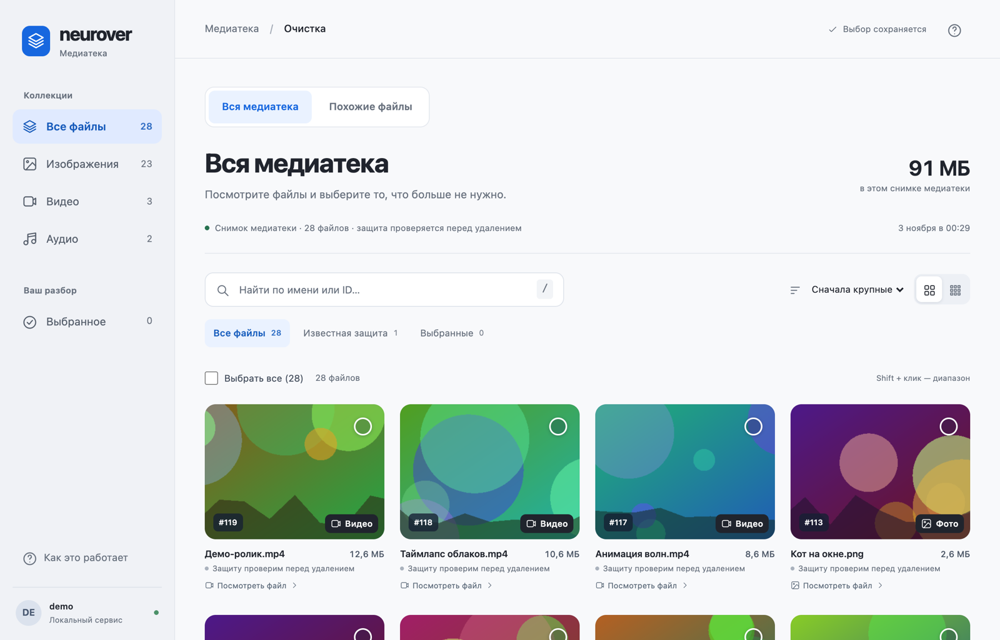
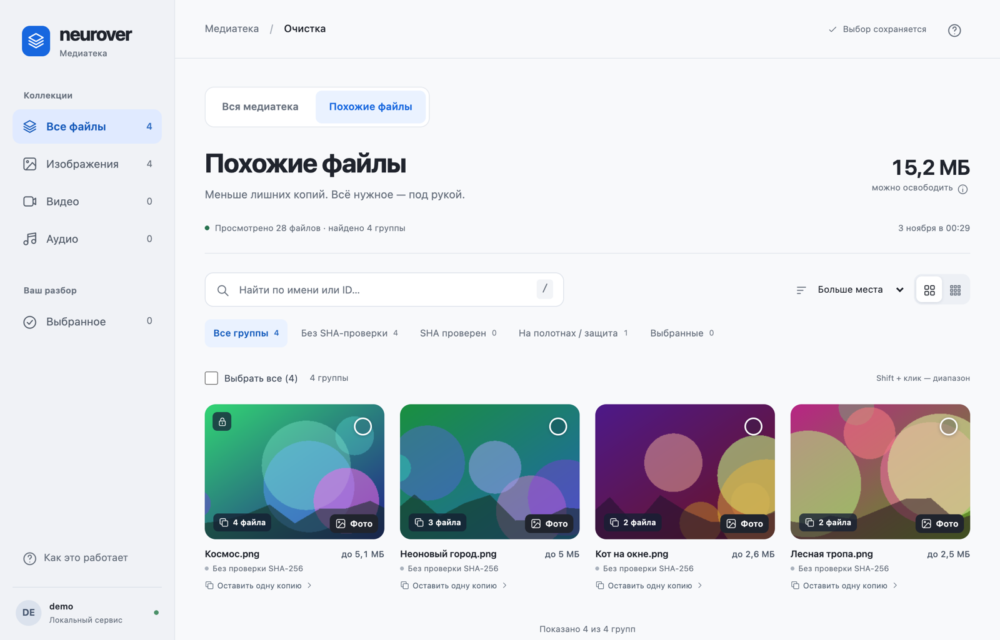
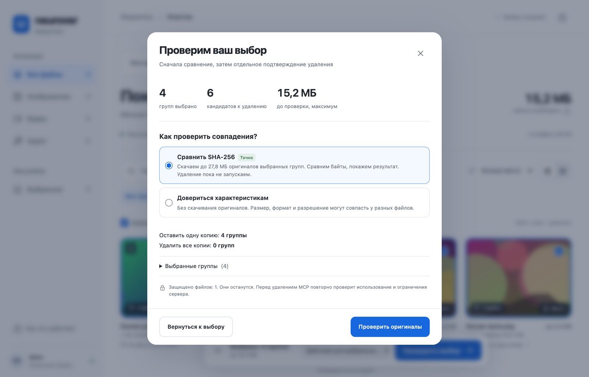
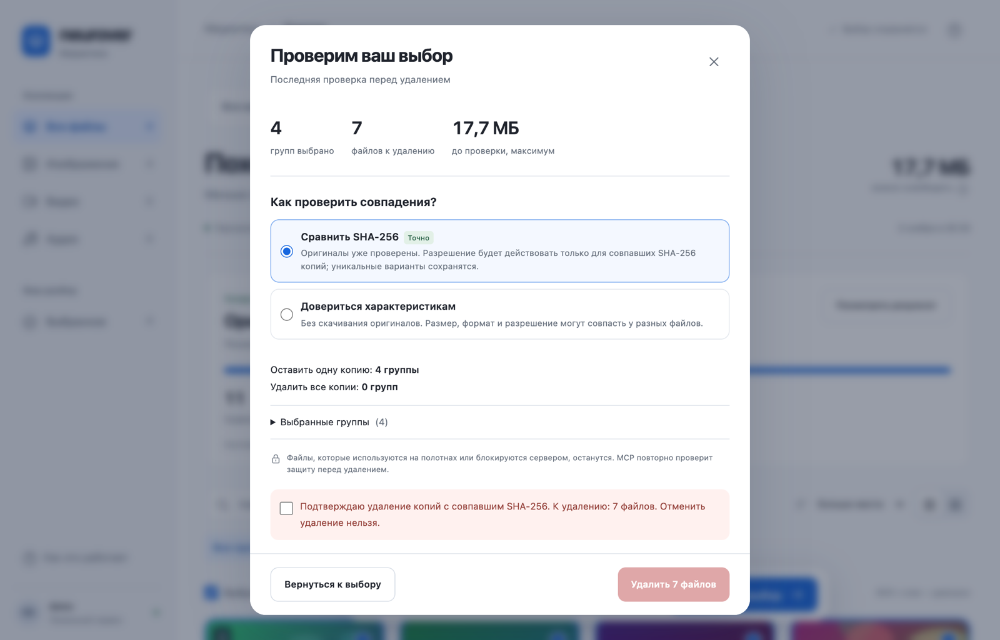
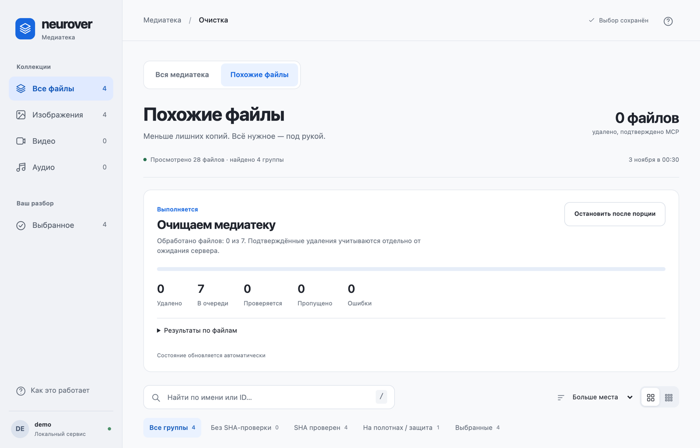

# Neurover MCP

Неофициальный локальный MCP-сервер для [neurover.io](https://neurover.io). Подключается к Claude, Cursor и другим MCP-клиентам и даёт AI-агенту работать с вашим аккаунтом Neurover: медиатека, поиск и очистка дублей, полотна (workflows), генерации.

Всё работает **на вашем компьютере** от имени **вашего** аккаунта. Сервера автора нет, данные никуда, кроме самого Neurover, не отправляются. Проект не связан с Neurover и не поддерживается ими.

## Установка

### Проще всего: попросить агента

Напишите своему AI-агенту (Claude, Cursor и т.п.):

> Установи Neurover MCP: https://github.com/vitalyor/neurover-api-mcp

Он всё сделает сам. От вас понадобится одно: в конце войти в Neurover в своём терминале — агент подскажет, что вставить.

### Одной командой

1. Если на компьютере нет Node.js, скачайте версию **LTS** с [nodejs.org](https://nodejs.org/) и установите как обычную программу.
2. Откройте терминал: на Mac — **Терминал** (найдите через Spotlight), на Windows — **PowerShell** (через Пуск).
3. Вставьте команду и нажмите Enter:

   macOS и Linux:
   ```sh
   curl -fsSL https://raw.githubusercontent.com/vitalyor/neurover-api-mcp/main/get.sh | sh
   ```
   Windows:
   ```powershell
   irm https://raw.githubusercontent.com/vitalyor/neurover-api-mcp/main/get.ps1 | iex
   ```
4. Ответьте на вопросы: имя аккаунта (любое, латиницей), email от Neurover, [режим входа](#вход-пароль-и-сессия), вход. В конце установщик найдёт Claude Desktop, Cursor и Windsurf и спросит, добавить ли Neurover в каждое из них. Перед правкой их настроек он сохраняет резервную копию.
5. Полностью закройте и снова откройте приложение. Готово.

Программа ставится в папку данных (см. [Где что хранится](#где-что-хранится)), в подпапку `app`. Администратор не нужен.

### Через AI-агента: инструкция для агента

1. Проверить Node.js 22.16+. Выполнить команду установки из раздела «Одной командой» для ОС пользователя. Без терминала установщик ставит программу и браузер и останавливается с подсказкой.
2. **Остановиться и спросить пользователя**, как MCP будет входить в Neurover, объяснив разницу (см. [Вход, пароль и сессия](#вход-пароль-и-сессия)):
   - **Вручную**: хранится только сессия; когда Neurover её завершит, пользователь входит снова командой `login`.
   - **Автоматически**: пароль хранится в системном хранилище ОС, MCP сам входит заново. Удобнее при регулярной работе.
3. Попросить пользователя выполнить в **своём** терминале команду `setup`, которую напечатал установщик, и выбрать там этот вариант. Там же он подключит Neurover к своим приложениям. Не просить пароль в чат.
4. Попросить пользователя полностью перезапустить приложение.

Другие варианты (git clone, ручное подключение, Linux): [docs/INSTALL.md](docs/INSTALL.md).

## Обновления

- **Сам проверяет, но не надоедает.** MCP проверяет новую версию на GitHub не чаще раза в неделю, в фоне. Если она вышла, агент скажет вам об этом **один раз за сеанс** и предложит обновить.
- **Проверить вручную**: попросите агента «проверь обновления Neurover» или выполните `update` (см. ниже).
- **Обновить**: согласитесь в чате — агент обновит сам. Или в терминале:
  ```sh
  node "<папка данных>/app/neurover.mjs" update
  ```
  Затем полностью перезапустите приложение.
- Обновление не начнётся, пока идёт фоновая очистка медиатеки. Аккаунты, вход и задания не затрагиваются, прежняя версия остаётся рядом.
- Автопроверку можно выключить: добавьте `"NEUROVER_UPDATE_CHECK": "0"` в `env` настроек MCP. Ручная проверка продолжит работать.
- Установка через `git clone` обновляется через `git pull`, если в папке нет ваших правок.

## Вход, пароль и сессия

MCP ходит в Neurover так же, как ваш браузер: по **сессии** (cookies), которая появляется после входа. Пока сессия действует, пароль не нужен. Neurover завершает сессию, например после бездействия, и тогда нужен новый вход. При установке вы выбираете, кто его делает:

| | 1. Вручную (по умолчанию) | 2. Автоматически |
|---|---|---|
| Что хранится | только сессия | сессия и пароль в хранилище ОС |
| Сессия закончилась | агент сообщит `login_required`; вы входите снова: `node "<папка данных>/app/neurover.mjs" login ИМЯ` или через окно браузера | MCP сам входит заново и повторяет запрос |
| Подходит | редкое использование, не хотите хранить пароль | регулярная работа, долгие фоновые задания |

Сам **вход** — через окно браузера на neurover.io или вводом пароля в терминале — только получает сессию и пароль не сохраняет. Режим меняется в любой момент: `node "<папка данных>/app/neurover.mjs" settings ИМЯ`.

### Где что хранится

Всё хранится **только на вашем компьютере**.

| Что | Где | Защита |
|---|---|---|
| Пароль (только в режиме 2) | Системное хранилище ОС: macOS Keychain, Windows Credential Manager, Linux Secret Service. Запись `neurover-api-mcp:ИМЯ` | Средствами ОС; в файлах MCP пароля нет |
| Сессия (cookies) | `<папка данных>/accounts/ИМЯ/session.json` | Файл доступен только вашему пользователю (0600) |
| Email и режим входа | `<папка данных>/accounts/ИМЯ/account.json` | Без пароля |
| Задания очистки, журналы, миниатюры | `<папка данных>/` | Личная папка |

Папка данных:

- macOS: `~/Library/Application Support/NeuroverMCP`
- Windows: `%LOCALAPPDATA%\NeuroverMCP`
- Linux: `~/.local/share/neurover-mcp`

Пароль никогда не попадает в настройки MCP-клиента, аргументы команд, переменные окружения, логи или чат. Сессия даёт доступ к аккаунту, поэтому не передавайте папку данных другим людям.

### Куда уходят данные

- **Только в Neurover**: на `https://neurover.io` и по ссылкам на файлы, которые выдаёт сам Neurover. Cookies отправляются только на `neurover.io`.
- **Никуда больше**: в коде нет сервера автора, аналитики и телеметрии. Это можно проверить: точки входа перечислены в [docs/PRIVACY.md](docs/PRIVACY.md).
- **GitHub** — при установке и обновлении скачивается сама программа, а раз в неделю запрашивается только номер последней версии. Данные аккаунта туда не отправляются.
- **При установке** зависимости скачиваются из npm, а Chromium — через Playwright.
- **AI-модель вашего клиента** видит то, что агент запрашивает через MCP: названия файлов, промпты, списки полотен. Пароль и cookies в ответы MCP не включаются.

Галерея очистки открывается только локально, на `http://127.0.0.1:8876`, и недоступна из сети.

### Как всё удалить

1. Переключите аккаунт на ручной вход — пароль будет удалён из хранилища ОС: `node "<папка данных>/app/neurover.mjs" settings ИМЯ`.
2. Удалите папку данных (см. выше) — исчезнут сессия, задания и журналы.
3. Уберите блок `neurover` из настроек MCP-клиента. Программа при установке одной командой лежит в той же папке данных (`app`) и удалится вместе с ней; копию из `git clone` удалите отдельно.

## Как агент работает с MCP

После подключения агент получает набор инструментов `neurover_*`. Вы просто пишете ему, что нужно: «покажи медиатеку», «найди дубли», «сгенерируй видео по этому кадру».

- **Чтение** (списки, баланс, медиатека, графы полотен) выполняется сразу и ничего не меняет.
- **Платные генерации** — в два шага: `prepare_generation` показывает актуальную цену и ничего не запускает, `submit_generation` запускает один раз с лимитом кредитов. При неясном результате генерация не повторяется автоматически.
- **Удаление** требует явного подтверждения: для медиа — точного имени файла, для полотна — `confirm`. Агент должен спрашивать вас перед такими действиями.
- **Очистка медиатеки** — через отдельную локальную страницу или силами самого агента, см. [Очистка медиатеки](#очистка-медиатеки).
- **Сессия закончилась**: в режиме 2 MCP входит заново сам. В ручном режиме агент сообщит `login_required` и предложит войти: командой `login` в вашем терминале или через инструмент `neurover_browser_login` — окно браузера откроется у вас, и вы войдёте на сайте сами.
- **Пароль агент не спрашивает никогда.** Если просит — это ошибка, не присылайте его.

## Очистка медиатеки

MCP умеет находить в медиатеке Neurover лишние копии и ненужные файлы и удалять их. Это можно делать двумя способами, и оба используют один и тот же MCP, одно и то же задание очистки и одни и те же защиты.

### Способ 1. Локальная страница очистки

Для больших медиатек удобнее работать глазами, а не в чате. Попросите агента, например: «найди дубли в медиатеке». Агент просканирует медиатеку (`neurover_cleanup_scan`) и даст ссылку на страницу вида `http://127.0.0.1:8876/...` (`neurover_cleanup_report`).

Эта страница — часть того же MCP, а не отдельный сайт. Её показывает локальный сервис MCP на вашем компьютере, из сети она недоступна. После того как вы нажмёте кнопку, проверка и удаление идут **автоматически, в фоновом процессе MCP, без агента и без запросов к AI-модели**: можно закрыть чат и даже вкладку, работа продолжится, пока включён компьютер. Если компьютер перезагрузился, попросите агента снова открыть страницу очистки и нажмите «Продолжить» — продолжится то же задание.

Скриншоты ниже сняты на демонстрационных данных.

**Вся медиатека.** Все файлы карточками: поиск по имени или ID, фильтры по типу, сортировка, выбор отдельных файлов, Shift для диапазона.



**Похожие файлы.** Группы кандидатов в дубли: совпадают размер, формат, разрешение и длительность. Для каждой группы — «оставить одну копию» или «удалить все копии». Значок замка — файл используется на полотне и не будет удалён.



**Проверка выбора.** Перед удалением страница предлагает сравнить оригиналы по SHA-256: MCP скачает их потоком, не сохраняя на диск, и подтвердит, что файлы совпадают побайтно. Это ничего не удаляет. Можно довериться и одним характеристикам, но тогда риск разных файлов придётся явно принять.



**Подтверждение удаления.** Удаление разблокируется только после того, как вы сами поставите отдельную галочку. Сохраняемая копия, уникальные варианты и файлы на полотнах остаются.



**Ход очистки.** Файлы удаляются порциями. Страница показывает удалённые, ожидающие, пропущенные и ошибки, обновляется сама. «Остановить после порции» ставит паузу, «Продолжить» возобновляет то же задание.



Когда очистка завершена, кнопка «Новая очистка» делает свежий разбор медиатеки, сохранив прошлый результат. Если страницу никто не открывает 10 минут, локальный сервис сам выключается; агент запустит его снова при следующем запросе.

### Способ 2. Агент чистит сам

То же самое агент может сделать в чате, без страницы: «удали копии в этих группах», «удали файлы с ID …». Он использует те же инструменты:

| Шаг | Инструмент |
|---|---|
| Найти кандидатов | `neurover_cleanup_scan` |
| Сравнить оригиналы по SHA-256 | `neurover_cleanup_verify` |
| Зафиксировать план с вашим согласием | `neurover_cleanup_approve` (группы) или `neurover_cleanup_approve_files` (точные ID) |
| Выполнить | `neurover_cleanup_start` (в фоне, без агента) или `neurover_cleanup_step` (по порции, в чате) |
| Статус, пауза, отмена | `neurover_cleanup_status`, `neurover_cleanup_pause`, `neurover_cleanup_cancel` |

Агент обязан спросить вас перед фиксацией плана; общая просьба «почистить» не считается согласием на удаление по одним характеристикам. Начать в чате и продолжить на странице (и наоборот) можно: это одно и то же задание.

### Что защищает от ошибок

- Удаляется только **утверждённый план**; после утверждения он не меняется.
- Перед каждой порцией MCP заново проверяет файл: не изменился ли он, не используется ли на полотне, на месте ли сохраняемая копия.
- Каждое удаление сначала записывается в локальный журнал, потом отправляется. Если ответ сервера потерялся, удаление **не повторяется вслепую**, а сверяется с медиатекой.
- Одновременно на аккаунт выполняется один план очистки.

## Разработка

```sh
npm test
```

Выпуск новой версии для пользователей: `npm version minor` (или `patch`) и `git push --follow-tags`. Обновлением считается только новый тег `vX.Y.Z`; обычные push в `main` пользователям не предлагаются.

Карта модулей: [docs/ARCHITECTURE.md](docs/ARCHITECTURE.md). Наблюдаемые контракты API Neurover: [docs/API-CONTRACTS.md](docs/API-CONTRACTS.md). Хранение и передача данных: [docs/PRIVACY.md](docs/PRIVACY.md).

## Лицензия

MIT, см. [LICENSE](LICENSE).
